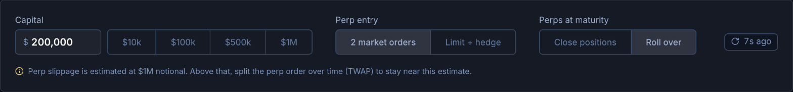
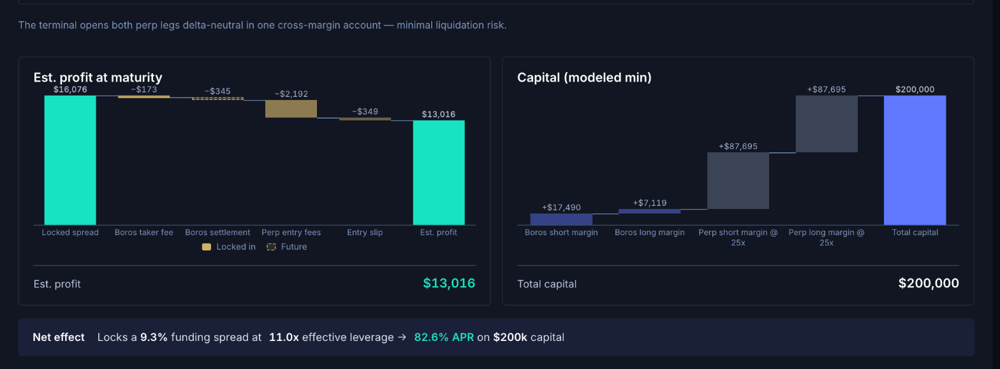
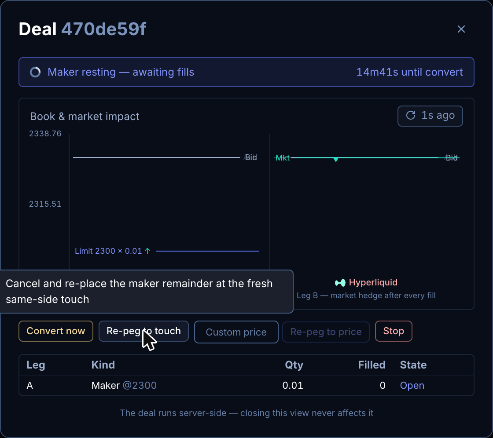
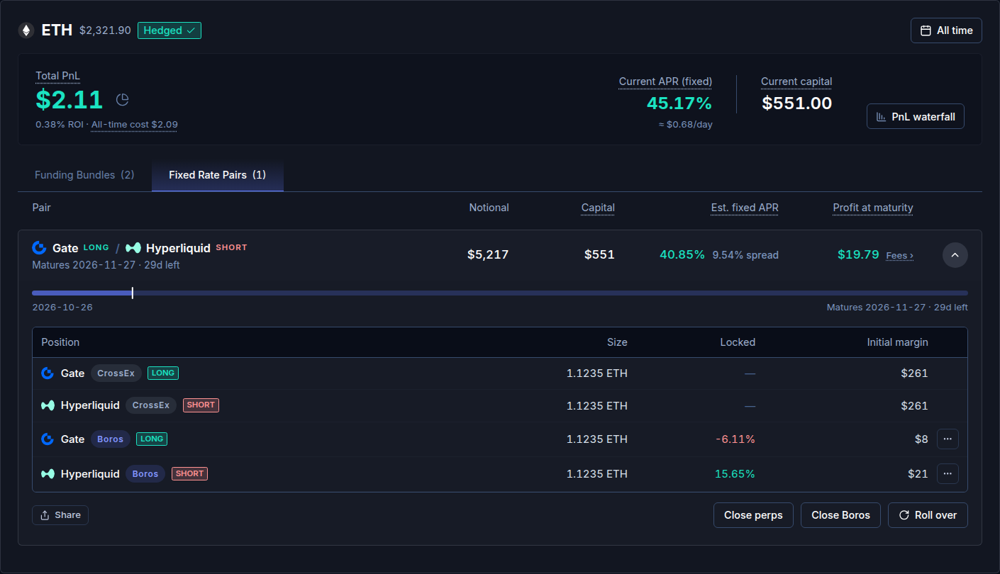
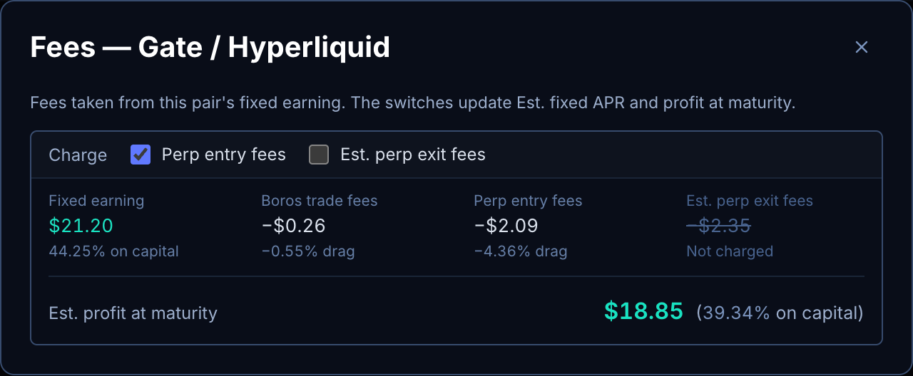

# User guide

In this guide, we will cover:
1. How to set up Gate and create an API key
2. How the strategy works
3. The recommended flow for using CrossEx Boros Terminal
4. How to maximise return
5. Risk Disclosure

## 1. How to set up Gate and create an API key

1. **Fund Gate** - sign up at [gate.com/signup](https://www.gate.com/signup) and deposit the capital you'll deploy.
2. **Enable CrossEx** - switch on the CrossEx feature at [gate.com/crossex](https://www.gate.com/crossex). The API key permission and the transfer step both need it enabled first.
3. **Fund CrossEx** - move funds into [CrossEx](https://www.gate.com/crossex), Gate's cross-exchange margin account.
4. **Create an API key** - in [API Management](https://www.gate.com/myaccount/api_key_manage), create an APIv4 key for your Trading account. Set IP Permissions to "Later" unless your machine has a consistent IP. Under Permissions, turn on:
   - **Cross-Exchange**: Read and Write - trade and transfer
   - **Spot Trading**: Read Only - see spot balances
   - Leave all others off, including Withdrawal

   Keys stay on this machine.
5. Paste the key into the terminal's **Gate API key** step.

## 2. How the strategy works

Perp traders pay (or earn) a floating funding rate. On [Boros](https://boros.pendle.finance), that funding rate is itself tradable - and the same coin's funding often carries **different implied fixed rates on different venues**: say ETH funding priced at 8% APR on Hyperliquid but 5% on Binance. The strategy locks in that gap.

One arbitrage holds 2 perps and 2 Boros positions, all at the same notional:

- **2 Boros positions** - short the funding of the expensive market (you *receive* its fixed rate) and long the funding of the cheap one (you *pay* its fixed rate). Receive 8%, pay 5% → ~3% locked until the market's maturity.
- **2 perp legs via CrossEx** - a short perp on the first venue, a long perp on the second, both opened through [Gate CrossEx](https://www.gate.com/crossex) under one **unified margin** account. Each perp leg's funding cancels the floating funding its Boros position owes, and the two perps cancel each other's price exposure - with the shared margin, one leg's gain collateralises the other's loss.

Some venue pairs have a Boros **spread market**, such as "ETH Spread HL-GATE": one Boros market that pays the funding gap between the two venues. Where Boros lists one, a single spread position replaces the 2 Boros positions, with one Boros order, one Boros fee and one margin. The arbitrage is then 2 perps + 1 spread position.

Once everything nets out there is no price exposure and no floating-rate exposure left - just the fixed spread, earned on the notional until maturity. The Opportunities scan prices that spread at your size, subtracts every cost it can model (Boros fees and price impact, perp fees and slippage, entry and exit), and shows what remains as a **net fixed APR on the capital** the perps and the Boros side actually consume as margin.

Boros Academy walks through this strategy in more depth: [Fixed-Return Funding Arbitrage](https://docs.pendle.finance/boros-academy/advanced-strategies/fixed-return-funding-arbitrage).

**Fixed does not mean risk-free** - see section 5.

## 3. The recommended flow for using CrossEx Boros Terminal
You will use the tool for 3 things, in order:

### A. Discover and understand opportunities
The bar above the **Opportunities** scan sets the assumptions every card is priced with:

- **Capital** is the margin you post across every position. Each card sizes its own notional to use this amount. The default is $200,000, and the presets are $10k, $100k, $500k and $1M.
- For **Perp entry**, **"2 market orders"** opens both perp legs at market. **"Limit + hedge"** means the terminal will place a limit order on exchange A, wait for it to be filled, and immediately market order on the other exchange to hedge. This will save on perp fees (because *maker* fees are cheaper than *taker* fees).
- For **Perps at maturity**, **"Roll over"** (the default) assumes you keep the perp legs open at maturity and lock another Boros spread on them at a later maturity, so no closing fee is charged. **"Close positions"** charges the fees and slippage to close both perp legs at maturity.
- The Boros positions are always priced as market orders at your size. Each Boros position shows its rate "after impact"; hover it to see the mid rate. Filling one of two single Boros positions with a limit order can do better (see section 4).
- Perp fees follow your Gate VIP tier once your Gate API key is connected. Without a key, a note above the cards says the fees assume the VIP 0 schedule.
- **Include rebate in APR** shows only when your logged-in Boros account has a settlement-fee rebate. It is on by default and adds the rebate to every card's APR and Return.
- Above $1M of notional per position, a note says the perp slippage is estimated at $1M. Above that size, split (TWAP) the perp side.

Each card shows its **APR** on capital, the **Capital** it posts, the **Return** by maturity and the **Notional** per position. Tick **"I already hold the perps"** on a card when you already hold those perps, for example to roll over: the card then charges no perp entry fees or entry slippage. It is ticked for you when you already hold the same pair at a sooner maturity.

**More details** breaks a card down: the positions on each venue, the **Est. profit at maturity** and **Capital (modeled min)** waterfalls, and the **Net effect** line. Try changing the assumptions to see how each cost moves.

Click **"Open this strategy"** on an opportunity to open it step by step: first **Lock the rate** (the Boros order), then **Hedge the perps** (the perp pair, sized from the card and your Perp entry choice). Each form is filled in for you, and you confirm each order yourself.

### B. Execute a Funding Rate Arbitrage position
It's recommended to **open the Boros side first**, before opening the perp legs. This is because the price impact from opening Boros position is higher and more uncertain, so you should "lock in" the Boros spread first before executing the whole position.

Do **connect your Boros wallet** and log in with it (in the setup steps, or in **Settings**), so that your Boros position can be tracked and traded.

#### Executing the 2 perp legs

Executing with **"2 market orders"** is relatively straight forward.

As for executing with **"Limit + hedge"**, there are a few things to note:
1. The Limit (maker) side is auto chosen to minimise total fees. The form shows it as **Maker leg … Auto**.
2. This is the flow:
   - The **Maker price** tracks the book: it sits one bid–ask gap behind the best bid/best ask and follows the market. Type a price to pin it; **track book** un-pins it.
   - Press and hold **"Execute pair"** to confirm. A limit order is immediately placed at the maker price, and the deal window opens.
   - Whenever the limit order is filled (or partially filled), the terminal automatically sends a market order on the other exchange to hedge the amount that was filled, and repeats until the whole limit order is filled.
   - **Convert to taker after** (1m, 5m or 15m; 5m by default) sets a countdown. If it reaches zero and the limit order is still not fully filled, the terminal cancels the limit order and completes the pair with market orders. The deal window shows the time left.
3. The deal window has four controls while the limit order rests:
   - **Convert now** cancels the rest of the limit order and completes both legs with market orders now.
   - **Re-peg to touch** moves the limit order to the current best bid/best ask on its side. Use it when the limit order has not filled for some time (for example when you typed a price that is far away).
   - Type a price in the box and click **Re-peg to price** to move the limit order to that price.
   - **Stop** ends the deal: it cancels the limit order, hedges whatever already filled, and finishes there. Press it before the countdown ends if you do not want the rest completed at market.

**Important:**
- You should try executing a **test amount first**, to get familiar with the flow, before executing a bigger amount
- When executing a large position, it's recommended to manually **break it into a few executions** (for example, do 5x 100k instead of 500k in one go)

### C. Monitor your position
Once opened, there's not much maintenance you need to do on a position, except for when to close the two perp legs at maturity (if you don't roll over
into the next maturity).

What's most useful is to understand and break down the PnL for your positions. The **Positions** tab shows one card per coin.

The top of each card shows:
- **Total PnL**, with its ROI and the all-time cost. Click the pie icon next to it for the PnL breakdown.
- **Current APR**: the fixed APR your pairs lock, and about how much that earns per day. When part of the book is not locked, it shows the fixed and the floating part.
- **Current capital**: the initial margin your counted positions need, on Gate and on Boros.
- **PnL waterfall** shows the PnL as bars: fixed funding, Boros trade, Boros trade fees, perp fees, perp basis and settlement rebate, then the net.

Below them are two tabs:
- **Fixed Rate Pairs** (the default) lists each pair: a Boros position matched with its perps, with its **Notional**, **Capital**, **Est. fixed APR** and **Profit at maturity**.
- **Funding Bundles** lists the perp funding and the Boros settlements per venue, for live and finished positions.

Click a pair to open it. It shows its positions and these buttons:
- **Share** makes a public link and image of the pair. Your wallet address is not included.
- **Close perps** closes both perp legs, reduce-only.
- **Close Boros** closes the pair's Boros positions. The perps stay open.
- **Roll over** moves the Boros positions to a later maturity. It is highlighted when the pair is due.

When a position is shared with another pair, Close perps and Close Boros close only this pair's share.

#### Fees on a pair

**Fees ›** under a pair's profit opens its fees window:

It shows the pair's **Fixed earning**, the **Boros trade fees** it paid, the **Perp entry fees**, the **Est. perp exit fees** and the **Est. profit at maturity**. The two **Charge** switches pick which perp fees count against this pair:
- **Perp entry fees**: what opening the perps cost. It is ticked, unless the perps were opened more than 3 days before the Boros position. Then the perps most likely came from an earlier pair you rolled over, and they paid their fees there.
- **Est. perp exit fees**: closing both perps at maturity at your venues' taker fees. It starts unticked, because perps are usually rolled over. Tick it if you mean to close them.

The switches change only that pair's Est. fixed APR and Profit at maturity. They are not saved: a reload sets them back.

#### When one position belongs to two pairs

Run HL/Gate and HL/Binance at the same time, and the HL side is **one** position at Gate, at one blended entry price. The terminal splits it by size between the pairs that use it. Each pair shows its slice, for example **(52.00%)**. Hover it to see the whole position, this pair's part and the other cards.

A position that no pair uses shows under **Ungrouped positions**, tagged **not in a pair**. A Boros position on the wrong side for its perp is tagged **Wrong side**: it adds to that perp's funding risk instead of hedging it. Close it before you open the hedge.

#### Leaving a position out

If a position, or part of one, is not part of the arb (for example one you trade by hand), on a Boros position open the **⋯** menu on its row in Fixed Rate Pairs and pick **Exclude**. For any position, you can also use the row's **Edit** button on the Funding Bundles tab. Set how much of it to exclude. That part moves to the **Excluded** section, out of the hedge, the PnL and the capital. **Restore** counts the whole position again. Exclusions are saved on the terminal.

#### What counts as your capital

Every APR on a position is a return *on capital*. Capital is the initial margin the positions post today: the perps' initial margin on Gate, plus the Boros positions' initial margin. A pair's capital is the sum over its positions. Idle cash in your accounts does not count.

#### Rebalancing USDC and USDT

Your CrossEx account has three wallets. Every venue except Hyperliquid and Lighter margins and settles in USDT. Hyperliquid and Lighter settle in USDC, so each has its own USDC wallet, which starts at 0.

Opening a perp leg does not borrow. Its margin comes from your whole account. A wallet moves only when its legs pay or receive: hourly funding, fees, and profit or loss. When a wallet's legs lose more than it holds, the wallet goes negative and Gate lends you the coin: USDC for the Hyperliquid and Lighter legs, USDT for the legs on every other venue. Gate counts the unrealised loss too, so a borrow can show while the cash is still positive.

The borrow costs two things. Gate holds 20% of it as initial margin and 10% as maintenance margin. It also pays interest:

| Wallet | Legs | Borrow interest |
|---|---|---|
| USDT · CrossEx | Gate, Binance, OKX, Bybit | From the first dollar |
| USDC · Hyperliquid | Hyperliquid | Free up to 10,000 USDC. The part over pays about 5% a year |
| USDC · Lighter | Lighter | From the first dollar, about 11% a year |

A Lighter borrow of $50 pays interest on all $50. A Hyperliquid borrow of $50 pays nothing.

A hedged pair is delta-neutral, but not margin-neutral. Gate liquidates the account when the margin balance falls to the maintenance margin, and the maintenance margin grows with a move against a USDC leg on Hyperliquid or Lighter: each leg's maintenance margin scales with its notional, and the losing leg drives its wallet negative, a borrow that adds 10% of itself to the maintenance margin. Each coin's card on the Positions tab carries a chip like `Liquidation ~$3,150 (+37%)`: the price of the coin at which the account liquidates if only that coin moves and every other coin holds still. Hover it to see the losing leg. It turns amber inside 30% and red inside 15%. A coin that can fall to $0 or rise without limit and never liquidate the account reads `No liquidation price`. If Gate's margin figures are missing, the chip reads `No liquidation estimate` rather than claiming safety.

The Accounts tab shows every account first: Gate CrossEx and each Boros account, with available against balance, initial margin used and maintenance margin used. An account liquidates when maintenance margin used reaches 100%. Below it is the CrossEx assets table. Under the table are your borrow, its interest now and the interest paid, then the rebalance button and **Manual transfer**. The button reads **Rebalance**, or **Clear debt** when clearing the debt is the better move. Hover a figure to see each wallet. Rebalance splits your CrossEx equity across the three wallets by position size. Each wallet's share is its legs at mark price, divided by all legs. Equity is cash plus unrealized profit or loss.

Example: $500 of positions on Gate, $250 on Hyperliquid and $250 on Lighter give 50%, 25% and 25%. With $1,000 of equity, the wallets aim for $500, $250 and $250. A wallet with no legs sends all its money to the wallets that have legs. With no open positions, there is nothing to rebalance, but Clear debt and Custom amount still work.

The Rebalance window has three ways to move money. It opens on the one the Accounts tab recommends:

- **Balance positions** splits your equity by position size, as above.
- **Clear debt** moves just enough to repay every borrow, from the wallet with the most equity.
- **Custom amount** moves the amount you type, from the wallet you pick to the wallet you pick. **Use a preset** goes back.

A preset with nothing to do is greyed, with the reason in its hover: `No open positions` or `No borrow`.

The window draws each wallet as a bar, captioned **After rebalance**, with its equity at the right. Hover a bar to see its cash, its unrealized PnL and its balanced target; a gold marker shows the target. The USDT and Hyperliquid rows always show. The USDC · Lighter row shows only when it has legs, money or a move.

USDC · Gate is one more CrossEx wallet for USDC, left over from a spot buy. It counts as margin, and a rebalance empties it. A round into Hyperliquid or Lighter sends that USDC on into the venue wallet. A round out to USDT sells it. A Convert sells it when it is worth 3 USDT or more.

The window lists the routes, and **Show steps** lists every step. Press and hold the button to start: **Hold to rebalance**, **Hold to clear debt** or **Hold to move**. When the window does not recommend the move, the button adds "anyway", for example **Hold to rebalance anyway**. When more than one wallet sends or receives, one hold runs every move, one after another. Convert and Spot loop always show. When Spot loop cannot run, its row is greyed with the reason, for example `The move is under the 11 USDC minimum.` The app marks the cheapest route that takes 15 minutes or less as **Recommended** and lists it first. You can pick another route. The routes are:

- **Spot loop**: runs rounds until every wallet reaches its target, at most 100 rounds. A last amount under the transfer minimum moves by Convert. If a round comes out smaller while it runs, the job can add a round, so the run can pass 15 minutes.
- **Spot loop, then Convert**: runs the rounds that fit in 15 minutes and give the lowest cost, then moves the rest with Convert.
- **Convert**: an instant swap inside CrossEx. It costs 0.2% of the amount moved. USDC between Hyperliquid and Lighter swaps twice, through USDT, so it costs about 0.4%. Gate takes at most 500,000 in one Convert, so a larger move runs as several Converts, 2 s apart.

The window shows the **Fee**, the **Interest** your borrow pays a month, now and after the move, and what the move **Frees**: the initial margin the repaid borrow stops locking. When the fee is 30 days or fewer of the interest it saves, the Accounts tab and the window read `Rebalance recommended.` (or `Clear debt recommended.`) with the days under it, for example `The fee equals 12 days of the interest it saves.` When the fee is more than 30 days of that interest, they read `Not worth it yet`. You can still move. A Hyperliquid borrow under 10,000 USDC pays no interest, so with no other borrow they read `No interest payment yet`. With no borrow at all they read `No borrow. No transfer or rebalancing necessary.`

If the fee rises by more than $1 or 5% while the window is open, **Refresh route** replaces the hold button. Press it to price the move again.

A round moves money through Gate spot, because Gate has no direct transfer between CrossEx wallets. Time and cost are for one round. Cost adds the spot fee and spread when the round buys or sells USDC.

| Round | What it does | Time | Gate fee |
|---|---|---|---|
| USDT to Hyperliquid | Buys USDC in CrossEx, moves it through Gate spot into the Hyperliquid wallet | About 2 min | $0.05 |
| Hyperliquid to USDT | Moves USDC out through Gate spot, back into CrossEx, sells it for USDT | About 6.5 min | $1.00 |
| USDT to Lighter | Buys USDC in CrossEx, moves it through Gate spot into the Lighter wallet | About 4 min | $1.03 |
| Lighter to USDT | Moves USDC out through Gate spot, back into CrossEx, sells it for USDT | About 3 min | Free |
| Hyperliquid to Lighter | Moves USDC out of Hyperliquid, through Gate spot, into Lighter | About 10 min | $2.03 |
| Lighter to Hyperliquid | Moves USDC out of Lighter, through Gate spot, into Hyperliquid | About 5 min | $0.05 |

A round moves 11 USDC or more. A round from Hyperliquid to Lighter moves 12 or more, so 11 still reaches Gate spot after the $1.00 fee. A smaller move goes by Convert.

Each round leaves at least 112% of initial margin in the account. With $29.41 of initial margin, at least $32.94 of margin balance stays. Gate refuses a move that would leave less than 110%. A borrow locks 20% of its size as initial margin. Early rounds are small, and later rounds grow as the borrow shrinks.

A finished run shows **Moved**, the amount that landed after fees. After Balance positions the chip reads **Balanced**, or **Done** when less landed than planned. After Clear debt or Custom amount it reads **Done**.

You cannot stop a run once it starts. A failed step stops it. An app restart stops it too. When Gate is already moving a step's money, the app first waits for that step to land, then stops. New deals and transfers wait while the run is running. A stopped run still blocks transfers, but not deals.

A stopped run shows **Resume** and **Abandon**. Resume first looks up the last send on Gate by its tag. When that lookup misses, it sweeps Gate's order history for the same tag. When Gate cannot confirm the order, the run stays stopped. Press Resume again. When Gate does not show a send after 2 min, the run stops. Resume looks again, and sends the step again only when Gate still does not show it. When Gate rate-limits the account, the run stops with **Gate is limiting requests from this account**. Nothing was sent. Press Resume a minute later. Gate allows 100 Convert quotes a day per account. When they are used up, the run stops and says so. Press Resume later: Gate's count clears within 24 hours. The app never sends a step twice on its own.

When a run stops, a banner at the top of every tab shows where the money is. Click **View** to open the Accounts tab.

After Abandon, any money left in Gate spot is plain spot money. Move it with Manual transfer.

#### Manual transfer between Gate spot and CrossEx

The **Manual transfer** button next to Rebalance opens a window. It moves USDT and USDC between your Gate spot wallet and your four CrossEx wallets. Gate's own website cannot do this.

Without Spot Trading Read Only on your key, the Assets table shows `Set Spot Trading to Read Only to see Gate spot balances.` The Gate spot tile in Manual transfer then reads `Balance hidden`. When an open Gate spot order holds part of a spot balance, hover that balance in the CrossEx assets table to see how much is free. The Gate spot tile in Manual transfer shows only the free amount.

Two tabs set the direction. **Into CrossEx** moves money from Gate spot into a CrossEx wallet. **Out of CrossEx** moves money from a CrossEx wallet to Gate spot.

There are eight paths, one for each wallet in each direction:

| Wallet | Coin | Into CrossEx | Out of CrossEx | Minimum |
|---|---|---|---|---|
| USDT · CrossEx | USDT | Free, about 3 s | Free, about 3 s | Gate's minimum, shown in the window |
| USDC · Gate | USDC | Free, about 5 s | Free, about 5 s | Gate's minimum, shown in the window |
| USDC · Hyperliquid | USDC | $0.05, about 2 min | $1.00, about 6.5 min | 11 USDC, fee included |
| USDC · Lighter | USDC | $1.03, about 4 min | Free, about 3 min | 11 USDC, fee included |

A move out of CrossEx is capped so 112% of initial margin stays in the account. With $29.41 of initial margin, at least $32.94 of margin balance stays. This is the same floor a rebalance round uses.

Transfers wait while a rebalance runs or is stopped, or while a deal is still working. Only one transfer moves at a time. If the app restarts mid-transfer, it never sends that transfer twice.

A deal waits a few seconds after a transfer starts, until Gate has taken the money.

## 4. How to maximise return
These few factors move the needle the most in maximising your return on the Funding Rate Arbitrage
1. Reduce perp fees with a **higher VIP tier** in Gate.
   * Play around with the VIP tier assumption in https://boros.pendle.finance/arbitrage-crossex, and you will see the immediate impact of your VIP tier on the potential returns.
   * As an example, my current VIP8 tier boosts a particular opportunity from **11.3% APR** to **16.2% APR**. For reference, I need a 400k capital in Gate to get VIP8 tier.
2. **Rolling over**
   * Being able to roll over an existing position into the next maturity is a powerful boost to your return
   * The boost is two-fold: the existing position will escape the perp closing fees, and the new position will escape the perp opening fees. On **Opportunities**, compare **Perps at maturity** set to **Close positions** with **Roll over** to see the impact on the return. Tick **"I already hold the perps"** on the next maturity's card to drop the perp entry fees. On a pair you hold, the **Fees ›** window shows the same with its **Perp entry fees** and **Est. perp exit fees** switches.
   * If you manage to keep rolling over, the subsequent position won't have to pay **a single cent of perp fees** (for both entry and exit), which boosts the return even more.
3. Reduce perp fees + slipapge through an optimised execution of **Limit + hedge**
   * The goal is to minimise slipapge when executing the **Limit + hedge**. Its even possible to get possible slippage (for example, short Hyperliquid ETH at 1601, long OKX ETH at 1600)
   * Its best to execute when the market is generally more calm, reducing risks for big slippage
   * Its best to break a big trade (lets say 1M notional) into multiple rounds, to reduce the average slippage
   * To be the most careful, always **manually set the maker price** at a price relatively further away, and do the execution in the **Deal modal**. At the deal modal, its a *mini-game* of re-pegging the limit order price decently close to market, patiently wait for it to get hit (say by other impatient users on the perp), trying to get an optimised slippage.
4. Optimise **Boros spread**
   * To optimise for the spread you are locking, with two single Boros markets, try to use a **limit order** on one and a **market order** on the other. Sometimes, it can give you a much higher spread.
   * That said, sometimes when a decent opportunity are there that you can just market order, you could just take it (otherwise, some other users might take it before you)

## 5. Risk Disclosure
- **CEX risk** - your funds custody with Gate.
- **Cross-margin risk** - CrossEx manages margin across exchanges for you.
- **Spread risk** - rare, but the perp legs could diverge enough to trigger liquidation.
- **Boros liquidation risk** - a big enough move against your locked-in spread can break the hedge; keep a margin buffer.
- **Execution risk** - if a position doesn't open hedged, check after execution.

Ultimately, you should **do your own research**, make sense of all the different risks and rewards, and make the decisions for yourself.