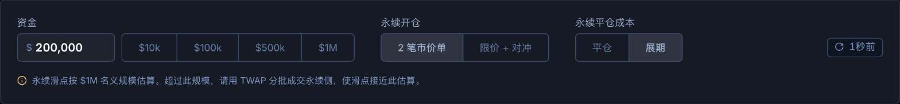
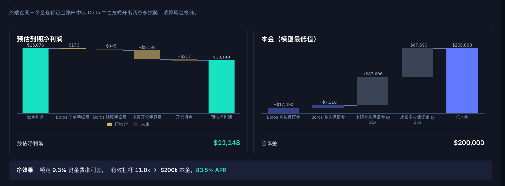
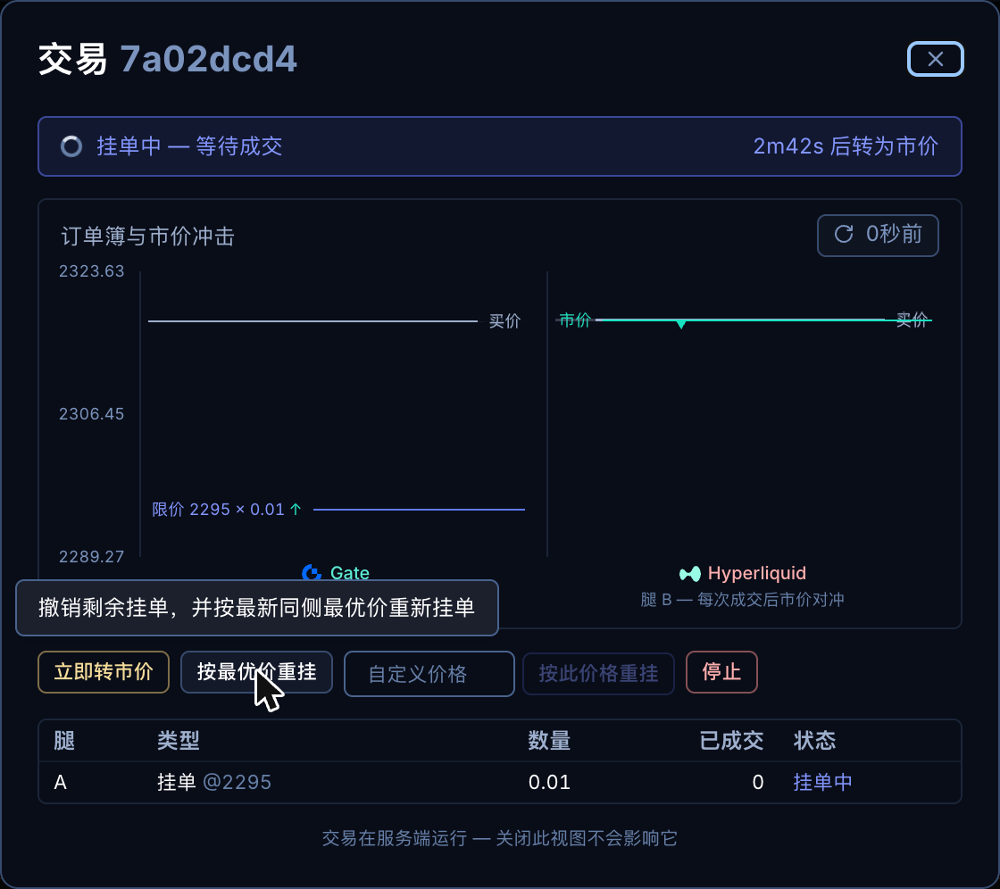
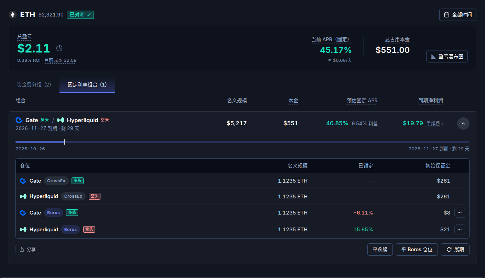
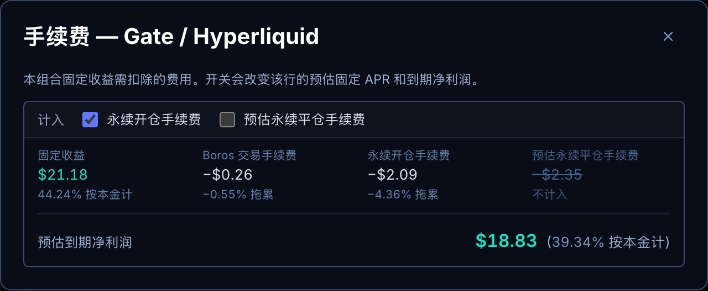

# 用户指南

> 本文是英文版 [USER_GUIDE.md](./USER_GUIDE.md) 的中文译本，两者如有出入，以英文版为准。

本指南包括以下内容：
1. 如何设置 Gate 并创建 API 密钥
2. 策略原理
3. 使用 CrossEx Boros Terminal 的推荐流程
4. 如何最大化收益
5. 风险披露

## 1. 如何设置 Gate 并创建 API 密钥

1. **向 Gate 入金** - 在 [gate.com/signup](https://www.gate.com/signup) 注册，并充值您准备投入的本金。
2. **开通 CrossEx** - 在 [gate.com/crossex](https://www.gate.com/crossex) 开通 CrossEx 功能。API 密钥权限和划转这两步都需要先开通它。
3. **为 CrossEx 注资** - 把资金划转到 [CrossEx](https://www.gate.com/crossex)，即 Gate 的跨交易所保证金账户。
4. **创建 API 密钥** - 在 [API 管理 (API Management)](https://www.gate.com/myaccount/api_key_manage) 中，为交易账户 (Trading account) 创建一个 APIv4 密钥。除非您的机器 IP 固定，否则 IP 权限 (IP Permissions) 选择“稍后” ("Later")。在权限 (Permissions) 下开启：
   - **跨所交易 (Cross-Exchange)**：读写 (Read and Write) - 交易和划转
   - **现货交易 (Spot Trading)**：只读 (Read Only) - 查看现货余额
   - 其他权限全部关闭，包括提款 (Withdrawal)

   密钥只保存在本机。
5. 把密钥粘贴到终端的 **Gate API 密钥 (Gate API key)** 步骤中。

## 2. 策略原理

永续合约交易者支付（或收取）浮动的资金费率。在 [Boros](https://boros.pendle.finance) 上，资金费率本身可以交易——而同一币种的资金费率在**不同交易所上的隐含固定利率往往不同**：比如 ETH 资金费率在 Hyperliquid 上定价为 8% APR，在 Binance 上却只有 5%。该策略锁定的就是这个差额。

一个仓位由 4 条腿组成，名义规模全部相同：

- **Boros 上的 2 条利率腿** - 做空较贵市场的资金费率（*收取*其固定利率），做多较便宜市场的资金费率（*支付*其固定利率）。收 8%，付 5% → 约 3% 锁定至该市场到期。
- **通过 CrossEx 的 2 条永续合约腿** - 在第一个交易所做空永续合约，在第二个交易所做多永续合约，两者都通过 [Gate CrossEx](https://www.gate.com/crossex) 在同一个**统一保证金**账户下开仓。每条永续合约腿的资金费，正好抵消其对应 Boros 腿应付的浮动资金费；两条永续合约腿的价格敞口互相抵消——由于保证金共享，一条腿的盈利可以为另一条腿的亏损提供抵押。

有些交易所组合在 Boros 上有**价差市场 (spread market)**，例如 "ETH Spread HL-GATE"：一个 Boros 市场直接支付两个交易所之间的资金费率差。Boros 上线了这样的市场时，一笔 Boros 订单即可代替 2 条利率腿，所以仓位只有 3 条腿，只付一次 Boros 手续费、只占一份保证金。

全部轧平后，既没有价格敞口，也没有浮动利率敞口——只剩下固定利差，按名义规模一直赚到到期。**机会**扫描会按您的规模为这个利差定价，扣除所有能建模的成本（Boros 手续费和价格冲击、永续合约手续费和滑点，含开仓和平仓），并把剩余部分显示为**按资金计算的净固定 APR**，这里的资金是指四条腿实际占用的保证金。

Boros Academy 对这个策略有更深入的讲解：[固定收益资金费率套利 (Fixed-Return Funding Arbitrage)](https://docs.pendle.finance/boros-academy/advanced-strategies/fixed-return-funding-arbitrage)。

**固定不等于无风险**——见第 5 节。

## 3. 使用 CrossEx Boros Terminal 的推荐流程
您会按顺序用这个工具做 3 件事：

### A. 发现并理解机会
**机会**扫描上方的假设栏，决定了每张卡片按什么假设定价：

- **本金**是您在所有腿上投入的保证金。每张卡片会按这个金额确定自己的名义规模。默认值为 $200,000，预设值有 $10k、$100k、$500k 和 $1M。
- **永续开仓**选 **“2 笔市价单”** 时，两条永续合约腿都用市价单开仓。选 **“限价 + 对冲”** 时，终端会在交易所 A 挂限价单，等它成交后，立即在另一个交易所下市价单对冲。这样可以节省永续合约手续费（因为*挂单 (maker)* 手续费比*吃单 (taker)* 手续费便宜）。
- **到期时的永续**选 **“展期”**（默认）时，假设到期时永续合约腿继续持有，并在之后的到期日上再锁定一个 Boros 利差，所以不计平仓手续费。选 **“平仓”** 时，计入到期时平掉两条永续合约腿的手续费和滑点。
- Boros 腿始终按您的规模以市价单定价。每条 Boros 腿显示“冲击后”的利率；把鼠标悬停在上面可查看中间利率。用限价单成交其中一条 Boros 腿可能拿到更好的利率（见第 4 节）。
- 连接 Gate API 密钥后，永续合约手续费按您的 Gate VIP 等级计算。没有密钥时，卡片上方会提示手续费按 VIP 0 费率估算。
- **APR 计入返佣**只在您登录的 Boros 账户有结算手续费返佣时显示。它默认开启，会把返佣计入每张卡片的 APR 和收益。
- 每条腿的名义规模超过 $1M 时，会提示永续滑点按 $1M 估算。超过这个规模，请把永续一侧拆分 (TWAP) 成交。

每张卡片显示按本金计算的 **APR**、投入的**本金**、到期的**收益**和每条腿的**名义规模**。如果您已经持有这些永续合约（例如要展期），在卡片上勾选 **“已有永续仓位”**：卡片就不再计入永续开仓手续费和开仓滑点。如果您在更早的到期日已持有同一组合，系统会自动勾选。

**更多明细**会拆解一张卡片：每个交易所上的腿、**到期利润**和**本金（模型最低值）**两张瀑布图，以及**净效果**一行。试着改变假设，看看每项成本如何变化。

在某个机会上点击 **“开启此策略”**，会分步开启它：先**锁定利率**（Boros 订单），再**对冲永续合约**（永续组合，规模取自卡片和您的永续开仓选择）。每个表单都会自动填好，每笔订单由您自己确认。

### B. 执行 4 腿资金费率套利仓位
建议**先开 Boros 腿**，再开永续合约腿。这是因为 Boros 开仓的价格冲击更大、更不确定，所以应先“锁定” Boros 利差，再执行整个 4 腿仓位。

务必**连接您的 Boros 钱包**并登录（在设置步骤中，或在**设置**中），这样才能跟踪和交易您的 Boros 仓位。

#### 执行 2 条永续合约腿

用 **“2 笔市价单”** 执行相对简单。

用 **“限价 + 对冲”** 执行时，有几点需要注意：
1. 限价（挂单）一方会自动选择，使总手续费最低。表单上显示为 **挂单腿 … 自动**。
2. 流程如下：
   - **挂单价格**跟随盘口：它挂在同侧最优价后一个买卖价差处，并随市场移动。输入价格即可固定；点击 **跟随盘口** 取消固定。
   - 长按 **“执行组合”** 确认。系统会立即按挂单价格挂出限价单，并打开交易任务窗口。
   - 每当限价单成交（或部分成交），终端会自动在另一个交易所下市价单，对冲已成交的数量，如此重复，直到整个限价单成交。
   - **转为吃单时限**（1m、5m 或 15m；默认 5m）设定一个倒计时。倒计时归零时如果限价单仍未完全成交，终端会撤销限价单，并用市价单完成该组合。交易任务窗口会显示剩余时间。
3. 限价单挂着时，交易任务窗口有四个控件：
   - **立即转市价**撤销限价单的剩余部分，立即用市价单完成两条腿。
   - **按最优价重挂**把限价单移到其同侧当前的最优买价/最优卖价。限价单一段时间仍未成交时使用（例如您输入的价格离盘口太远）。
   - 在输入框中输入价格，点击 **按此价格重挂**，把限价单移到这个价格。
   - **停止**结束这个交易任务：撤销限价单，对冲已成交的部分，然后结束。如果不希望剩余部分按市价完成，请在倒计时结束前点击它。

**重要：**
- 先用**小额测试**执行，熟悉流程后再执行更大的金额
- 执行大仓位时，建议手动**拆成几次执行**（例如分 5 次各 100k，而不是一次 500k）

### C. 监控仓位
开仓后，4 腿仓位基本不需要维护，只需在到期时决定何时平掉两条永续合约腿（如果您不展期到下一个到期日）。

最有用的是理解并拆解各个仓位的盈亏。**持仓**标签页为每个币种显示一张卡片。

每张卡片顶部显示：
- **总盈亏**，以及 ROI 和全部成本。点击旁边的饼图图标可查看盈亏明细。
- **当前 APR**：您的组合锁定的固定 APR，以及大约每天赚多少。如果部分仓位没有锁定，会分别显示固定和浮动部分。
- **当前本金**：计入的各条腿在 Gate 和 Boros 上所需的初始保证金。
- **盈亏瀑布图**把盈亏画成柱状：固定资金费、Boros 交易、交易手续费、永续手续费、永续价格盈亏和结算返佣，最后是净额。

下面有两个标签页：
- **固定利率组合**（默认）列出每个组合：一个 Boros 仓位与其永续合约配对，显示**名义规模**、**本金**、**预估固定 APR** 和**到期净利润**。
- **资金费分组**按交易所列出永续资金费和 Boros 结算，包括持仓中和已结束的腿。

点击一个组合可展开它。展开后显示各条腿和以下按钮：
- **分享**生成该组合的公开链接和图片，不包含您的钱包地址。
- **平永续**以只减仓方式平掉两条永续合约腿。
- **平 Boros 腿**平掉该组合的 Boros 腿，永续合约保持持仓。
- **展期**把 Boros 腿移到之后的到期日。组合到期临近时它会高亮。

如果某条腿与另一个组合共用，平永续和平 Boros 只平掉本组合的那一份。

#### 组合的手续费

组合到期净利润旁的 **手续费 ›** 会打开它的手续费窗口：

窗口显示该组合的**固定收益**、已付的 **Boros 交易手续费**、**永续开仓手续费**、**预估永续平仓手续费**和**到期净利润（预估）**。两个**计入**开关决定哪些永续手续费计入本组合：
- **永续开仓手续费**：开永续合约的成本。默认勾选，除非永续合约比 Boros 腿早 3 天以上开仓。这种情况下，永续合约很可能来自您之前展期过的组合，已经在那里付过手续费。
- **预估永续平仓手续费**：到期时按您所在交易所的吃单费率平掉两条永续合约。默认不勾选，因为永续合约通常会展期。如果您打算平仓，就勾选它。

开关只改变该组合的预估固定 APR 和到期净利润。它们不会被保存：刷新页面后恢复默认。

#### 当一条交易所腿属于两个组合时

同时运行 HL/Gate 和 HL/Binance 时，HL 这一侧在 Gate 上是**一个**仓位，只有一个混合开仓价。终端会按规模把它分给使用它的各个组合。每个组合显示自己的份额，例如 **(52.00%)**。把鼠标悬停在上面，可查看整个仓位、本组合的部分和其他卡片。

没有组合使用的腿显示在**未分组的腿**下，标为 **未配对**。与其永续合约方向相反的 Boros 腿标为 **方向错误**：它不但没有对冲，反而增加了该永续合约的资金费风险。请先平掉它，再开对冲。

#### 把一条腿排除在外

如果一条腿（或其中一部分）不属于这个套利（例如您手动交易的仓位），对于 Boros 腿，在固定利率组合中打开其所在行的 **⋯** 菜单，选择 **排除**。任何腿也都可以在资金费分组标签页中，用该行的 **编辑** 按钮操作。设置要排除这条腿的多少。被排除的部分会移到**已排除**区域，不再计入对冲、盈亏和资金。**恢复**会把整条腿重新计入。排除设置保存在终端上。

#### 什么算作您的资金

仓位上的每个 APR 都是*本金*收益率。本金是各条腿当前占用的初始保证金：永续合约在 Gate 上的初始保证金，加上 Boros 仓位的初始保证金。一个组合的本金是其各条腿之和。账户里闲置的现金不计入。

#### USDC 与 USDT 再平衡

您的 CrossEx 账户有三个钱包。除 Hyperliquid 和 Lighter 外，所有交易所都以 USDT 作保证金和结算。Hyperliquid 和 Lighter 以 USDC 结算，所以各有一个自己的 USDC 钱包，初始余额为 0。

开一条腿不会产生借款。它的保证金来自整个账户。钱包只在其腿支付或收取款项时变动：每小时资金费、手续费和盈亏。当某个钱包的腿亏损超过钱包余额时，钱包变为负数，Gate 会借给您该币种：Hyperliquid 和 Lighter 的腿借 USDC，其他所有交易所的腿借 USDT。Gate 也计入未实现亏损，所以现金仍为正时也可能显示借款。

借款有两项成本。Gate 把借款的 20% 作为初始保证金、10% 作为维持保证金占用。借款还要付利息：

| 钱包 | 腿 | 借款利息 |
|---|---|---|
| USDT · CrossEx | Gate, Binance, OKX, Bybit | 从第一美元起计息 |
| USDC · Hyperliquid | Hyperliquid | 10,000 USDC 以内免息。超出部分年化约 5% |
| USDC · Lighter | Lighter | 从第一美元起计息，年化约 11% |

在 Lighter 借款 $50，全部 $50 都要付息。在 Hyperliquid 借款 $50，不付任何利息。

对冲组合是 Delta 中性的，但不是保证金中性的。当保证金余额跌到维持保证金时，Gate 会清算账户；而当价格朝不利于 Hyperliquid 或 Lighter 上某条 USDC 腿的方向变动时，维持保证金会增加：每条腿的维持保证金随其名义规模变化，亏损的腿会让其钱包变为负数，形成借款，而这笔借款又会给维持保证金增加其自身的 10%。**持仓**标签页上每个币种的卡片都带有一个类似 `清算 ~$3,150（+37%）` 的标签：即只有该币种变动、其他币种都不动时，账户被清算时该币种的价格。把鼠标悬停在上面可查看亏损的那条腿。距离在 30% 以内时变为琥珀色，15% 以内时变为红色。如果某个币种跌到 $0 或无限上涨都不会让账户被清算，标签显示 `无清算价格`。如果缺少 Gate 的保证金数据，标签显示 `无清算估算`，而不会声称安全。

**账户**标签页先列出每个账户：Gate CrossEx 和每个 Boros 账户，显示可用与余额、已用初始保证金和已用维持保证金。已用维持保证金达到 100% 时，账户会被清算。下方是 CrossEx 资产表。表格下方显示您的借款、当前利息和已付利息，然后是再平衡按钮和 **手动划转**。这个按钮显示 **再平衡**；如果清偿债务更合适，则显示 **清偿债务**。把鼠标悬停在数字上可查看每个钱包的情况。再平衡会按仓位规模把您的 CrossEx 权益分配到三个钱包。每个钱包的份额等于其腿按标记价格计算的价值，除以所有腿的总值。权益等于现金加未实现盈亏。

示例：Gate 上有 $500 的仓位、Hyperliquid 上 $250、Lighter 上 $250，对应 50%、25% 和 25%。权益为 $1,000 时，三个钱包的目标分别是 $500、$250 和 $250。没有腿的钱包会把全部资金转给有腿的钱包。没有持仓时无需再平衡，但清偿债务和自定义金额仍然可用。

再平衡窗口有三种划转方式，打开时默认选中账户标签页推荐的那一种：

- **按仓位平衡**：按仓位规模分配权益，如上所述。
- **清偿债务**：从权益最多的钱包划转刚好足够的金额，使每个负余额钱包归零。
- **自定义金额**：按您输入的金额，从您选择的钱包划转到您选择的钱包。点击 **使用预设** 返回。

没有可做之事的预设会显示为灰色，悬停可查看原因：`暂无持仓` 或 `无借款`。

窗口把每个钱包画成一条柱，标题为 **再平衡后**，右侧显示其权益。把鼠标悬停在柱上，可查看其现金、未实现盈亏和平衡目标；金色标记表示目标位置。USDT 和 Hyperliquid 行始终显示。USDC · Lighter 行只在有腿、有资金或有划转时显示。

USDC · Gate 是 CrossEx 中另一个 USDC 钱包，存放现货买入后剩余的 USDC。它计入保证金，再平衡会将其清空。转入 Hyperliquid 或 Lighter 的一轮会把这部分 USDC 一并转入该交易所的钱包。转出到 USDT 的一轮会把它卖出。兑换只在其价值达到 3 USDT 或以上时将其卖出。

窗口列出各条路线，**显示步骤** 会列出每一步。按住按钮开始：**长按再平衡**、**长按清偿债务** 或 **长按划转**。当窗口不推荐这次划转时，按钮会变为“仍要……”，例如 **仍要再平衡（长按）**。当有多个钱包转出或转入时，按住一次即可依次完成所有划转。兑换和现货循环始终显示。现货循环无法执行时，该行显示为灰色并给出原因，例如 `划转金额低于 11 USDC 的最低限额。` 应用会把用时不超过 15 分钟、成本最低的路线标为 **推荐** 并排在第一位。您也可以选择其他路线。路线如下：

- **现货循环**：分轮执行，直到每个钱包达到其目标，最多 100 轮。最后低于划转最低额的部分通过兑换完成。如果运行中某一轮金额变小，任务可能会增加一轮，所以运行时间可能超过 15 分钟。
- **现货循环，然后兑换**：执行 15 分钟内能完成且成本最低的若干轮，然后用兑换处理剩余部分。
- **兑换**：CrossEx 内的即时兑换。费用为划转金额的 0.2%。Hyperliquid 与 Lighter 之间的 USDC 需经 USDT 兑换两次，费用约 0.4%。Gate 单次兑换上限为 500,000，所以更大的金额会分成多次兑换，每次间隔 2 秒。

窗口显示 **费用**、您的借款每月要付的 **利息**（当前值和划转后的值），以及这次划转 **释放** 的金额：即还掉的借款不再占用的初始保证金。当费用不超过它所节省的 30 天利息时，账户标签页和窗口显示 `建议再平衡。`（或 `建议清偿债务。`），下方显示天数，例如 `费用相当于可节省的 12 天利息。` 当费用超过这 30 天的利息时，显示 `暂不划算：费用超过可节省的 30 天利息。` 您仍然可以划转。在 Hyperliquid 借款低于 10,000 USDC 时不付利息，所以如果没有其他借款，显示 `暂未产生利息，无需划转或再平衡。` 完全没有借款时，显示 `无借款，无需划转或再平衡。`

如果窗口打开期间费用上涨超过 $1 或 5%，**刷新路线** 会取代长按按钮。点击它重新报价。

每一轮都经 Gate 现货划转资金，因为 Gate 不支持 CrossEx 钱包之间直接划转。时间和成本都按一轮计算。当这一轮买入或卖出 USDC 时，成本还包括现货手续费和价差。

| 轮次 | 作用 | 时间 | Gate 手续费 |
|---|---|---|---|
| USDT 到 Hyperliquid | 在 CrossEx 内买入 USDC，经 Gate 现货划转到 Hyperliquid 钱包 | 约 2 分钟 | $0.05 |
| Hyperliquid 到 USDT | 把 USDC 经 Gate 现货转出，回到 CrossEx，卖出换成 USDT | 约 6.5 分钟 | $1.00 |
| USDT 到 Lighter | 在 CrossEx 内买入 USDC，经 Gate 现货划转到 Lighter 钱包 | 约 4 分钟 | $1.03 |
| Lighter 到 USDT | 把 USDC 经 Gate 现货转出，回到 CrossEx，卖出换成 USDT | 约 3 分钟 | 免费 |
| Hyperliquid 到 Lighter | 把 USDC 从 Hyperliquid 转出，经 Gate 现货，转入 Lighter | 约 10 分钟 | $2.03 |
| Lighter 到 Hyperliquid | 把 USDC 从 Lighter 转出，经 Gate 现货，转入 Hyperliquid | 约 5 分钟 | $0.05 |

每轮至少划转 11 USDC。从 Hyperliquid 到 Lighter 的一轮至少划转 12 USDC，这样扣除 $1.00 手续费后仍有 11 USDC 到达 Gate 现货。更小的金额通过兑换完成。

每轮都会在账户中保留至少 112% 的初始保证金。初始保证金为 $29.41 时，至少保留 $32.94 的保证金余额。Gate 会拒绝让保证金低于 110% 的划转。借款会锁定其规模 20% 的初始保证金。前几轮金额较小，随着借款减少，后面几轮会变大。

运行完成后显示 **已划转**，即扣除手续费后到账的金额。按仓位平衡完成后，标签显示 **已平衡**；如果到账金额少于计划，则显示 **完成**。清偿债务或自定义金额完成后，显示 **完成**。

运行一旦开始就无法停止。某一步失败会让它停止。应用重启也会让它停止。如果 Gate 正在划转某一步的资金，应用会先等这一步到账，然后停止。运行期间，新的交易和划转都会等待。已停止的运行仍会阻止划转，但不会阻止交易。

已停止的运行会显示 **恢复** 和 **放弃**。恢复时，会先按标签在 Gate 上查找最后一次发送。查不到时，会在 Gate 的订单历史中搜索同一标签。如果 Gate 无法确认该订单，运行保持停止。请再次点击恢复。如果 2 分钟后 Gate 仍未显示某次发送，运行会停止。恢复会再查一次，只有 Gate 仍未显示时才重新发送这一步。当 Gate 对账户限频时，运行会停止并显示 `Gate 正在限制此账户的请求频率，未发送任何请求。请一分钟后点击恢复。` Gate 每个账户每天允许 100 次兑换报价。用完后，运行会停止并给出提示。请稍后再点击恢复：Gate 的计数会在 24 小时内清零。应用绝不会自行把同一步发送两次。

运行停止时，每个标签页顶部都会显示一条横幅，说明资金在哪里。点击 **查看** 打开账户标签页。

放弃后，留在 Gate 现货中的资金就是普通的现货资金。请用手动划转转走。

#### Gate 现货与 CrossEx 之间的手动划转

再平衡旁边的 **手动划转** 按钮会打开一个窗口。它在您的 Gate 现货钱包与四个 CrossEx 钱包之间划转 USDT 和 USDC。Gate 官网本身做不到这一点。

如果您的密钥没有现货交易只读 (Spot Trading Read Only) 权限，资产表会显示 `将现货交易设为只读，即可查看 Gate 现货余额。` 此时手动划转中的 Gate 现货卡片显示 `余额不可见`。当 Gate 现货中有未成交的挂单占用部分现货余额时，把鼠标悬停在 CrossEx 资产表中的该余额上，可查看可用金额。手动划转中的 Gate 现货卡片只显示可用金额。

两个标签页决定方向。**转入 CrossEx** 把资金从 Gate 现货转入某个 CrossEx 钱包。**转出 CrossEx** 把资金从某个 CrossEx 钱包转到 Gate 现货。

共有八条路径，每个钱包每个方向各一条：

| 钱包 | 币种 | 转入 CrossEx | 转出 CrossEx | 最低金额 |
|---|---|---|---|---|
| USDT · CrossEx | USDT | 免费，约 3 秒 | 免费，约 3 秒 | Gate 的最低限额，窗口中显示 |
| USDC · Gate | USDC | 免费，约 5 秒 | 免费，约 5 秒 | Gate 的最低限额，窗口中显示 |
| USDC · Hyperliquid | USDC | $0.05，约 2 分钟 | $1.00，约 6.5 分钟 | 11 USDC，含手续费 |
| USDC · Lighter | USDC | $1.03，约 4 分钟 | 免费，约 3 分钟 | 11 USDC，含手续费 |

从 CrossEx 转出的金额有上限，确保账户中保留 112% 的初始保证金。初始保证金为 $29.41 时，至少保留 $32.94 的保证金余额。这与再平衡每一轮使用的下限相同。

当再平衡正在运行或已停止，或者有交易任务仍在执行时，划转会等待。同一时间只进行一笔划转。如果应用在划转中途重启，绝不会把这笔划转发送两次。

划转开始后，交易任务会等待几秒，直到 Gate 收到资金。

## 4. 如何最大化收益
以下几个因素对提高 4 腿资金费率套利的收益影响最大：
1. 用 Gate 的**更高 VIP 等级**降低永续合约手续费。
   * 在 https://boros.pendle.finance/arbitrage-crossex 调整 VIP 等级假设，就能立即看到 VIP 等级对潜在收益的影响。
   * 举个例子，我目前的 VIP8 等级把某个机会从 **11.3% APR** 提高到 **16.2% APR**。作为参考，我需要在 Gate 有 400k 资金才能达到 VIP8 等级。
2. **展期**
   * 能把现有的 4 腿仓位展期到下一个到期日，会大幅提高收益
   * 提升来自两方面：现有仓位省掉永续合约平仓手续费，新仓位省掉永续合约开仓手续费。在**机会**页上，把 **到期时的永续** 在 **平仓** 和 **展期** 之间切换，就能看到对收益的影响。在下一个到期日的卡片上勾选 **“我已持有这些永续”**，即可去掉永续开仓手续费。对于您已持有的组合，**手续费 ›** 窗口中的 **永续开仓手续费** 和 **预估永续平仓手续费** 开关也能看到同样的效果。
   * 如果能一直展期，后续的 4 腿仓位**一分钱永续合约手续费都不用付**（开仓和平仓都不用），收益会更高。
3. 通过优化 **限价 + 对冲** 的执行，降低永续合约手续费和滑点
   * 目标是执行 **限价 + 对冲** 时尽量减少滑点。甚至可能拿到正滑点（例如，在 Hyperliquid 以 1601 做空 ETH，在 OKX 以 1600 做多 ETH）
   * 最好在市场整体较平静时执行，降低大幅滑点的风险
   * 最好把大额交易（比如名义规模 1M）拆成多轮执行，降低平均滑点
   * 最稳妥的做法是：始终**手动设置挂单价格**，设在离市场相对较远的位置，并在**交易任务窗口**中执行。在交易任务窗口里，这就像一个*小游戏*：把限价单价格重新挂到离市场足够近的位置，耐心等它被吃（比如被永续合约市场上其他急于成交的用户吃掉），争取更优的滑点。
4. 优化 **Boros 利差**
   * 要优化锁定的利差，尽量用**限价单**成交至少一条 Boros 腿，另一条腿用**市价单**。有时这能带来高得多的利差。
   * 话虽如此，有时出现了直接用市价单就能吃下的不错机会，直接吃下即可（否则其他用户可能会抢先）

## 5. 风险披露
- **CEX 风险** - 您的资金由 Gate 托管。
- **全仓保证金风险** - CrossEx 替您跨交易所管理保证金。
- **价差风险** - 很少见，但两条永续合约腿的价格可能偏离到足以触发清算。
- **Boros 清算风险** - 价格朝不利于您锁定利差的方向大幅变动，可能破坏对冲；请保留保证金缓冲。
- **执行风险** - 如果某条腿开仓后未处于对冲状态，执行后请检查。

最终，您应当**自行研究 (DYOR)**，理解各种风险与回报，并自己做决定。
